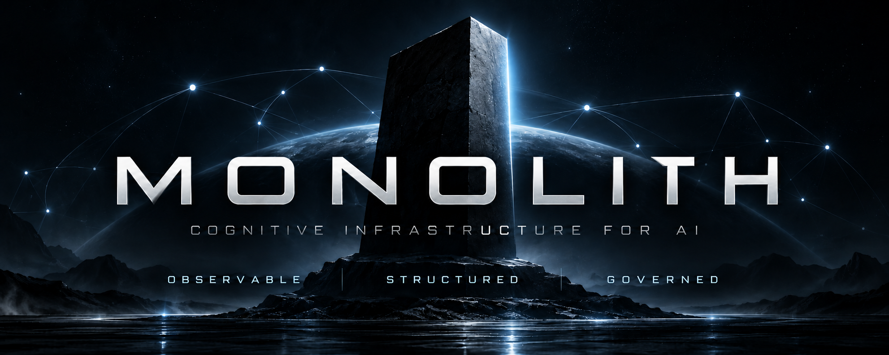

<p align="center">
  
</p>

<h1 align="center">MONOLITH</h1>

<p align="center">
  <strong>Cognitive Infrastructure for AI</strong><br>
  Observable · Structured · Governed
</p>

<p align="center">
  <a href="./LICENSE"></a>
  <a href="./package.json">= 20"></a>
  
  <a href="https://hub.xerj.org/contributors/Demion-L"></a>
</p>

---

MONOLITH is cognitive infrastructure for AI-assisted development. It gives a
human and an AI assistant a shared, inspectable record of a project —
structured knowledge, explicit read and write boundaries, and traceable
decisions — instead of relying on an assistant's unaided memory.

> **[MANIFESTO.md](./MANIFESTO.md)** — why this project exists and the engineering principles that govern it.
> **[AGENTS.md](./AGENTS.md)** — current scope, source structure, and the authoritative entry point for AI assistants working in this repository.

## Why MONOLITH?

AI assistants lose context between sessions, and what a project "knows" ends up
scattered across chats, notes and habits. MONOLITH addresses this with
mechanisms that are deterministic and testable:

- **Observability** — project state is readable from the terminal (`monolith brief`) and in a local, read-only web interface (Mission Control), including whether that state looks stale.
- **Structured knowledge** — structure is extracted from a project's own markdown (frontmatter, headings, explicit links) into an explicit relationship graph. No embeddings, no LLM, no fuzzy matching.
- **Execution governance** — protocols, skills and cognitive modes describe how an assistant reads and updates project memory. Mission lifecycle is a recorded discipline, not a runtime gate (see [Project Status](#project-status)).
- **Reproducibility** — same input, same output. State lives in a schema-versioned file written with a lock and atomic replace; Durable State adds a hash-chained, crash-safe event log.
- **Explicit boundaries** — reads and writes of managed files go through strict, bounded, symlink-refusing primitives; `monolith validate` never executes project code; Mission Control has no write endpoint.

## Quick Start

Requires Node.js >= 20. MONOLITH is an alpha package that is **not published
to npm**. Build it from a clone:

```bash
git clone https://github.com/Demion-L/the_monolith.git
cd the_monolith
pnpm install
pnpm build
npm link             # exposes the `monolith` command (or run: node dist/cli/index.js)
```

Then, in a project directory:

```bash
monolith init        # scaffold a MONOLITH instance (refuses to overwrite existing files)
monolith brief       # bounded, read-only summary of project state
monolith ui          # Mission Control at http://127.0.0.1:4173 ; Ctrl+C to stop
```

`monolith ui` must be run inside a directory that contains a MONOLITH
instance, and it does not open a browser — open the printed address yourself.

## Core Capabilities

| Capability | What it does | Command |
|---|---|---|
| Scriptorium + ERG | Deterministic structural extraction from markdown and an explicit relationship graph | library |
| Coordinatorium | Mission lifecycle and checkpoints in `.monolith/state.json` | `monolith mission` |
| Context Gateway | Bounded, read-only project summary for AI sessions, with a freshness verdict and a reconciliation report | `monolith brief` |
| Validation | Static instance integrity checks | `monolith validate` |
| Durable State | Hash-chained, crash-safe execution log for long-running tasks (security acceptance still open, see `AGENTS.md`) | `monolith durable` |
| Mission Control | Read-only local web dashboard on `127.0.0.1` | `monolith ui` |

## Architecture

```text
Markdown artifact
  → Scriptorium (structural extraction)
    → ERG (explicit relationship graph)
      → governed project memory (working / long-term, ADRs, roadmap)

MONOLITH Kernel (src/)  ──►  Project Instance (.monolith/, monolith.config.json)
                                   │   safe, bounded reads (ADR-014)
                                   ▼
                      Read model ──► loopback HTTP API ──► Mission Control UI
```

> **Kernel knows HOW. Instance knows WHAT.** The Kernel (`@monolith/core`)
> holds generic mechanics and has no hardcoded knowledge of any project. An
> Instance — the `.monolith/` directory plus `project.definition.mjs` of a
> project using MONOLITH, this repository included — supplies the project's
> own knowledge.

Kernel modules in `src/`: `scriptorium`, `graph`, `coordinatorium`, `brief`,
`durable`, `validate`, `readmodel` / `http` (Mission Control back end), `root`
(safe read/write primitives) and `init` / `cli`. The UI lives in `ui/`
(Vue 3 + Vite) and is built into `dist/ui`.

## Ecosystem

- **[Latysh Development](https://github.com/Demion-L)** — developer of MONOLITH.
- **[Webway](https://github.com/Demion-L/webway)** — a separate, independently developed project on semantic and associative knowledge linking. It was extracted from MONOLITH and has no runtime coupling to it.
- **SphynX** — a related application. MONOLITH does not depend on it, and this repository does not document it as a current consumer of MONOLITH.

## Community & Recognition

MONOLITH is listed as a contributor project on
[XERJ Corpus Hub](https://hub.xerj.org/contributors/Demion-L). At the time of
writing, the contributor page exists, a MONOLITH commit is selected, the corpus
status is `candidate` and the manifest is `draft`. This is a contribution
listing — not an official partnership, endorsement or certification.

## Documentation

- [`AGENTS.md`](./AGENTS.md) — scope, source structure, session boot sequence
- [`MANIFESTO.md`](./MANIFESTO.md) — mission and engineering principles
- [`docs/README.md`](./docs/README.md) — knowledge-base index
- [`docs/adr/README.md`](./docs/adr/README.md) — architecture decision records
- [Reference](#reference) below — CLI, Mission Control, security contract and platform notes

## Project Status

**Alpha** (`0.1.0-alpha.0`). The API and CLI are experimental and may change
without notice. Not published to npm.

**Not yet implemented:** a write-enabled UI, authentication for Mission
Control, `monolith context <topic>`, `monolith status`, `monolith dry-run`, the
enforcement gate engine and integrity validators (type declarations only),
and protocol drift detection. Mission lifecycle commands are a recommended
discipline, not a runtime gate. Threat-model limits (concurrent adversarial
mutation unsupported, Windows unverified) are in [Security & Limitations](#security--limitations).
`AGENTS.md` is the authoritative status record.

## License

[MIT](./LICENSE) © 2026 Dmytro Latysh

---

# Reference

## Mission Control

Mission Control is a local, **read-only** web interface over a MONOLITH
project. It answers "where is this project right now?" without reading
`state.json` or governance files by hand. It never changes the project:
there is no write endpoint, it does not run `monolith validate`, and it does
not execute `project.definition.mjs` (ADR-010).

**Sections** (the active one is kept in the URL hash, e.g. `#roadmap`):

| Section | Shows |
|---|---|
| Project Overview | Project name, instance root, `state.json` schema/revision, mission counts |
| Current Mission | Active missions |
| Checkpoints | Latest checkpoints per active mission |
| Roadmap | Roadmap index of the instance |
| Diagnostics | Per-source read status (absent / forbidden / corrupt / unreadable) and notes |

**LIVE and DEMO.** LIVE is the default: the page loads `GET /api/dashboard`
from the server that launched it, and a failed load is shown as an error —
it never silently falls back to sample data. DEMO (`?mode=demo`) shows
built-in fixture data and is only entered explicitly; it is marked
`DEMO DATA`.

**Skins.** *Classic* (default) and *Cosmic Glass* are two visual skins of the
same interface; the choice is stored in the browser (`localStorage`) and
changes nothing about the data.

**Limitations.** Read-only; no authentication (loopback is not treated as
authentication); listens on `127.0.0.1` only and has no option to change
that; one project per server, fixed at start. See
[ADR-010](./docs/adr/ADR-010-mission-control-ui.md) and
[Security & Limitations](#security--limitations).

## CLI

```bash
npx monolith init       # scaffold a new instance from templates/ (implemented)
npx monolith validate   # check instance integrity (implemented, see below)
npx monolith mission    # Tactical Coordinatorium: start|list|show|finish|checkpoint|checkpoints (implemented, see ADR-008)
npx monolith brief      # deterministic, read-only project-state summary [--max-chars N] [--strict] (implemented)
npx monolith ui         # Mission Control, read-only web dashboard [--port N] (implemented)
npx monolith ui dev     # Mission Control with Vite hot reload [--port N] (implemented, source checkout only)
npx monolith status     # show active protocol, phase, story, drift summary (not yet implemented)
npx monolith dry-run    # simulate finalization gate without writes (not yet implemented)
```

`status` and `dry-run` currently print `not yet implemented` and exit 1 — see
`src/cli/index.ts`.

### `monolith ui`

```bash
monolith ui [--port N]       # default port 4173
monolith ui dev [--port N]   # default port 5173 (Vite)
monolith ui --help
monolith ui dev --help
```

`monolith ui` serves the prebuilt Mission Control (`dist/ui`) and the
read-only `GET /api/dashboard` API from one server on `127.0.0.1`, for the
project in the current directory. It needs neither Vite nor any
devDependency, and works from the installed package. Ctrl+C or SIGTERM stops
it and frees the port.

`monolith ui dev` is for working on the interface: it starts the same API on
a free loopback port and a Vite dev server (hot module reload) that proxies
`/api/dashboard` to it. It needs a source checkout with devDependencies
installed and exits with an error otherwise. `--port` sets the Vite port.

- `--host` is deliberately **not** supported (the server is loopback-only).
- Errors (not a MONOLITH project, bad or busy port, unknown argument, missing UI build) print one line and exit `1`.
- A browser is never opened automatically.

### `monolith init`

Scaffolds a new MONOLITH instance into `process.cwd()`. There is no
positional target-directory argument — `cd` into the directory you want to
scaffold first. Any positional argument or unrecognized flag is a hard
error (non-zero exit), never silently ignored.

`init` refuses to run — before writing anything — if any file it would
write already exists (`AGENTS.md`, `monolith.config.json`, any file under
the target `.monolith/`, the AI-tool instruction file, etc.), listing the
conflicting paths. `--yes` only skips the interactive prompts for project
metadata on an otherwise-clean directory; it does not authorize overwriting
existing data, and re-running `init` against an already-initialized project
is refused rather than treated as an upgrade. The one exception is
`.monolith/state.json` (Coordinatorium runtime data, ADR-008), which is
never written to if it already exists and is not treated as a conflict.

Writes are safe against pre-existing links (SEC-001B.2, ADR-012): `init`
refuses a symlink — including a dangling one — at a target or in any parent
directory (even one that stays inside the project), a FIFO or other special
file, and a file that appears after the preflight; files are created without
overwriting and each becomes visible only once completely written. `init` as a
whole is **not** atomic and does not coordinate two concurrent runs: files
published before a failure stay.

### Platform, permissions and shared directories

The write guarantees (ADR-012) are stated for **POSIX** (verified on Linux).
macOS/BSD are expected to behave the same but are not verified; **Windows is
best-effort and unverified** — dangerous objects the checks can still see are
refused, but no guarantee is made, and a `PLATFORM_BEST_EFFORT` warning is
printed once. Network filesystems (NFS/SMB) are outside the guarantees.
Nothing defends against another local process that swaps directories or
symlinks while a command runs (SEC-001B.3, open): concurrent adversarial
mutation is **not supported** (TM-C, ADR-013). A trusted local project is
supported with limitations; a static adversarial project is only **partially**
supported (TM-B, ADR-013 — proposed). Since SEC-001B.1-R (ADR-014) managed files
are read through one strict contract: a symlink anywhere below an explicit
boundary, a non-regular file and a file with other hard links are refused, so a
hostile repository can no longer make a managed path expose another file through
a link. TM-B is **not** re-stated as supported by that merge: it awaits a recorded
re-evaluation. Known gaps: LOCK-RELEASE-001 and BRIEF-DOCDIR-001
(`.monolith/memory/long-term/tech-debt.md`). Not covered: a write-enabled UI
(ADR-010's blocker is preserved) and any TM-C adversary.

A new `state.json` and the lock file are created `0600`; replacing an existing
`state.json` keeps its mode. In a directory **shared between users or
containers with different uids**, others can then no longer read `state.json`
or inspect the lock: use one uid, or `chmod` the file deliberately.
`mission start|finish|checkpoint` also refuse a symlinked `.monolith` (or any
symlinked component) and a `state.json` that has other hard links; replace the
link with a real directory/file first. A crash can leave `state.json.tmp.*`,
`state.json.lock.creating.*` or `state.json.lock.recovery` files; MONOLITH
never deletes them automatically (FS-CLEAN-001).

### Programmatic API: explicit write scope

`mutateState`, `startMission` and `finishMission` no longer accept a plain
directory string; pass a scope (ADR-012):

```ts
// before
await startMission(dir, { title, system });
// after — the directory and ALL its ancestors are trusted by the caller
await startMission(trustedDirectoryTarget(dir), { title, system });
// after — acting on a project; nothing below projectRoot may be a symlink
await startMission(projectTarget(projectRoot, join(projectRoot, '.monolith')), { title, system });
```

Calling without a scope throws `SafeWriteError` (`WRITE_SCOPE_REQUIRED`).
Read functions (`readState`, `listMissions`, `getMission`) are unchanged.

### `monolith validate`

Checks that the current directory contains a valid MONOLITH instance. Three
checks run in sequence:

| Check | What it verifies |
|---|---|
| Configuration | `monolith.config.json` present, valid JSON, a valid contained `monolithRoot`; `project.definition.mjs` present as a file (see below) |
| Instance | All required directories exist under `monolithRoot` |
| Templates | No unreplaced init-time placeholders (`{{VAR}}`) left in generated files |

Exit codes: `0` = PASS, `1` = FAIL. Use `--quiet` for CI (prints nothing on PASS, errors only on FAIL).

**`validate` never executes project code (SEC-002, ADR-011).** `project.definition.mjs`
is checked **as a file only**: it exists, stays inside the project (any symlink in
its path is a FAIL, ADR-014), is a regular file (a FIFO or device is a FAIL and is
never opened for reading), is non-empty, and is at most 1 MiB. It is not
imported, evaluated or parsed as JavaScript, so a PASS says **nothing** about
its syntax, whether it exports `PROJECT_DEFINITION` (that check was removed),
whether its content is safe, or whether it could be executed. A successful
non-quiet run prints a note saying exactly this. `monolith.config.json` and
`AGENTS.md` are read through the same bounded, strict reader
(1 MiB cap, no blocking on FIFOs, no symlinks — ADR-014). Residual risk: path checks and `open()` are
separate syscalls, so a local attacker racing a path swap is not stopped
(SEC-001B, open).

```
MONOLITH validate

Configuration   PASS
Instance        PASS
Templates       PASS

Result: PASS
```

**What `monolith validate` does _not_ check yet:** `project.definition.mjs`
declares several fields — `requiredFinalizationDocs`, `requiredRootArtifacts`,
`driftLogPath`, `forcedInjectionTerms`, `mistakeRoots` — that describe a
richer integrity contract (required finalization documents, required root
artifact IDs, a drift log). None of these are currently read or enforced by
`src/validate/index.ts`; they are a declared-but-unconsumed contract reserved
for a future enforcement engine. See `project.definition.mjs` for inline
notes on which of its own fields are currently unenforced.

### `monolith brief`

```bash
monolith brief [--max-chars N] [--strict]
```

Prints a compact, deterministic summary of current project state: State
Keeper status, active missions and their latest checkpoints (with next
steps), mandatory protocols, the current story excerpt from
`.monolith/memory/working/active.md`, and accepted ADRs. Each section names
its source. It is strictly read-only (no files created, `state.json` read
once, no LLM or network), and it supplements — does not replace — the
Boot Sequence in `AGENTS.md`.

- The first line is `Completeness: COMPLETE` or `INCOMPLETE`. INCOMPLETE
  means information was lost or could not be read (corrupted/empty
  `state.json`, corrupted `monolith.config.json`, an unreadable or
  out-of-project document directory, or content that did not fit the
  budget); the Diagnostics section says why.
- `--max-chars N` sets the budget (default 6000). Mandatory content is never
  truncated; if it alone exceeds the budget it is shown in full and flagged.
- Exit codes: `0` brief formed, `1` usage error, `2` `--strict` and INCOMPLETE.
- Extra ADR directories can be listed in `monolith.config.json` under
  `contextGateway.adrDirs` (relative to the project root; this repository
  uses `["docs/adr"]`).
- `monolithRoot` must be a relative path inside the project root (ADR-009,
  SEC-001A; TOCTOU tracked as SEC-001B, open). An absent `monolith.config.json`
  means the default `.monolith`; an existing but corrupted one makes
  `mission *` refuse (fail closed) rather than write to the default. `monolith context <topic>` is not implemented.

## Security & Limitations

- Mission Control and its API are read-only and bound to `127.0.0.1`; the
  `Host` header is allow-listed (DNS-rebinding defence), `Origin` is checked,
  no CORS headers are sent, only `GET` is accepted. There is no
  authentication, and loopback is not authentication.
- The UI cannot start `validate`, run project code or choose another project
  root; the root is fixed when the server starts.
- Threat model: trusted local project supported with limitations; static
  adversarial project partially supported; concurrent adversarial mutation
  (TM-C) unsupported (ADR-013). A write-enabled UI remains blocked (ADR-010).
- Platform and filesystem caveats are described under
  [Platform, permissions and shared directories](#platform-permissions-and-shared-directories).

## Development

```bash
pnpm install
pnpm test            # Core tests (vitest)
pnpm typecheck       # tsc --noEmit
pnpm build           # compile to dist/
pnpm test:ui         # UI tests
pnpm typecheck:ui    # vue-tsc
pnpm build:ui        # build the UI into dist/ui (committed; rebuild after UI changes)
node dist/cli/index.js ui dev    # UI development with hot reload
```

`dist/ui` is tracked in Git and shipped in the npm package, so rebuild it
(`pnpm build:ui`) whenever `ui/` changes.
