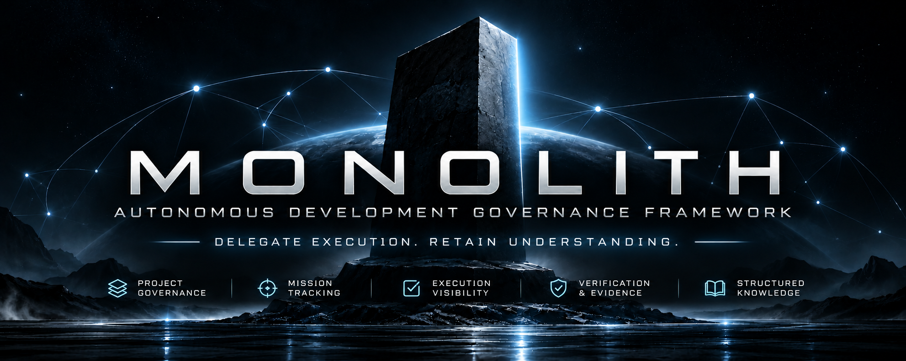

<p align="center">
  
</p>

<h1 align="center">MONOLITH</h1>

<p align="center">
  <strong>Autonomous Development Governance Framework</strong><br>
  <em>Delegate Execution. Retain Understanding.</em>
</p>

<p align="center">
  <a href="./LICENSE"></a>
  <a href="./package.json">= 20"></a>
  
  <a href="https://hub.xerj.org/contributors/Demion-L"></a>
</p>

---

MONOLITH is an open-source framework for governing AI-assisted and autonomous
software development.

It connects project knowledge, architectural decisions, development workflows,
execution history and verification evidence into a structured, inspectable
system. As AI coding agents take on more responsibility, MONOLITH helps
developers retain visibility into what is being built, why decisions were made,
how work progressed and what remains unfinished.

MONOLITH does **not** write code. It is not an AI coding agent, an IDE, a
replacement for Git or a general agent orchestrator. It is a governance layer
that sits next to the coding agent you already use. Today the one supported
agent integration is [Claude Code](https://claude.com/claude-code); the core is
host-agnostic.

**AI can write your code. MONOLITH helps you stay in control.**

> **[MANIFESTO.md](./MANIFESTO.md)** — why this project exists and the engineering principles that govern it.
> **[AGENTS.md](./AGENTS.md)** — current scope, source structure, and the authoritative entry point for AI assistants working in this repository.

## Why MONOLITH?

An AI coding agent can now carry out a large task on its own. The more it does
without you, the more you have to answer afterwards:

- What did the agent actually change, and under which task?
- Which decisions were made, and where are they written down?
- What did the last session leave unfinished, and who picks it up?
- Which of the agent's claims ("tests pass") were checked, and which are only reported?
- When two agents work in parallel, who owns what?

A chat history is a poor place for these answers. It belongs to one session, it
is hard to search, and the next session does not inherit it. The gap between
*the task was executed* and *a person understands the result* grows with every
unattended hour.

MONOLITH closes that gap by keeping project knowledge, missions, checkpoints and
evidence in the repository itself, as plain Markdown and JSON that a person and
an agent can both read, check and commit.

**Who it is for:** developers, technical founders and small teams who use Claude
Code or similar tools and want to delegate substantial work without losing track
of it.

## How It Works

```text
Human Intent
     │
     ▼
Project Governance        stories · roadmap · ADRs · protocols
     │
     ▼
AI Coding Agent           your agent (Claude Code is the supported adapter)
     │
     ▼
Mission Tracking          missions · checkpoints · ownership
     │
     ▼
Implementation
     │
     ▼
Evidence & History        provenance-labelled evidence · Development History
     │
     ▼
Human Review              handover check · explicit finalize approval
     │
     ▼
Project Continuity        the next session starts from recorded state
```

The diagram is conceptual. MONOLITH does not launch, drive or orchestrate an
agent. The agent works inside your repository and follows the project's
instructions; MONOLITH records, checks and shows what happened. With the opt-in
[Managed Execution](#managed-execution) mode it can additionally refuse
implementation steps that are not enrolled in a Mission — for the tool calls a
supported host routes through its hook.

## Core Capabilities

Capabilities are listed by what they are for. Where a capability only exists on
`main` (not in the published beta), it is marked *(Beta 3/4)*; see
[Status & Limitations](#status--limitations).

### Development Governance

- **Structured project context** — an instance (`.monolith/`) with project memory, protocols and skills.
- **Stories, roadmap and ADRs** — what is being built and why, kept as Markdown.
- **Governance diagnostics** — `monolith governance check` is a read-only check of the governance documents' format and content.
- **Finalize workflow** — closing a story is an explicit, owner-approved step with a plan digest (`monolith finalize`).

### Autonomous Execution Discipline

- **Missions and checkpoints** — `monolith mission` records what an agent is doing and where it stopped.
- **Mission Auto-Enrollment** *(Beta 3)* — when Managed Execution is enabled, MONOLITH can enroll supported Claude Code implementation actions into a traceable Mission.
- **Managed Execution** *(Beta 3)* — opt-in, with limited coverage of host tools; see [below](#managed-execution).
- **Mission ownership and handoff** *(Beta 3)* — a Mission belongs to one worktree; another context takes it over only through an explicit, recorded `mission handoff`.
- **Context recovery** — opt-in Claude Code hooks give a new or compacted session a bounded recovery packet. *(Beta 3)* A restarted session in the same worktree resumes its Mission; a crash never closes anything.

### Execution Visibility

- **Mission Control** — a local, read-only web interface (`monolith ui`).
- **Development History, Execution Graph, Project Overview** — missions, checkpoints and relationships as recorded.
- **Project continuity** — `monolith brief` summarizes project state in the terminal, including whether it looks stale.

### Verification & Accountability

- **Evidence** — `monolith evidence run` runs a command and records its exit status; `monolith evidence report` records only a statement. Each record carries explicit provenance and verification status (OBSERVED vs. REPORTED). Evidence is **not** tamper-evident.
- **Handover** — `monolith handover check` compares what was reported with what is recorded and verified: progress, missions, ADRs, evidence, and the limits of the report.
- **Governance Check** — format and consistency of the governance documents.

### Knowledge Management

- **Structured Markdown knowledge** — structure is extracted from a project's own Markdown (frontmatter, headings, explicit links) into an explicit relationship graph. No embeddings, no LLM, no fuzzy matching.
- **Idea Capture** — park a thought that is unrelated to the current task with `monolith idea add`, and recall it later with `monolith idea list|show`.
- **Knowledge Lab** — ideas and hypotheses, shown read-only in Mission Control.

MONOLITH provides governance workflows, execution visibility and explicit review
boundaries. It does not guarantee that code, decisions or an agent's actions are
correct, and it does not claim a complete history of everything an agent did.

## Quick Start

Requires Node.js >= 20. The published pre-release is `0.2.0-beta.2`, under the
`beta` dist-tag:

```bash
npm install -g @latysh-development/monolith@beta
```

`0.2.0-beta.4` is prepared but **not yet published**. The Git tag `v0.2.0-beta.3`
exists, but `0.2.0-beta.3` was never published to npm; Beta 4 supersedes it and contains
everything in its notes. Features marked *(Beta 3/4)* in this README (Mission
Auto-Enrollment, Managed Execution, ownership and handoff) are on `main` and reach npm
only when Beta 4 is released. To try them earlier, build from source or install a locally
built tarball — see the [installation and release guide](./docs/release/alpha-installation.md).
The previous alpha (`0.1.0-alpha.4`) remains available as `@alpha`. Release notes:
[`0.2.0-beta.2`](./docs/release/0.2.0-beta.2.md) (published),
[`0.2.0-beta.3`](./docs/release/0.2.0-beta.3.md) (tagged, not published),
[`0.2.0-beta.4`](./docs/release/0.2.0-beta.4.md) (prepared).

Then, in a project directory:

```bash
monolith init        # scaffold a MONOLITH instance (refuses to overwrite existing files)
monolith validate    # static integrity check of the instance
monolith brief       # bounded, read-only summary of project state
monolith governance check   # read-only check of the governance documents' format and content
monolith handover check     # read-only handover of autonomous work: progress, missions, ADRs, evidence (REPORTED vs VERIFIED)
monolith ui          # Mission Control at http://127.0.0.1:4173 ; Ctrl+C to stop
```

`monolith ui` must be run inside a directory that contains a MONOLITH
instance, and it does not open a browser — open the printed address yourself.
All commands: [CLI reference](./docs/reference/cli.md).

Capture an idea without leaving your task (optional):

```bash
monolith idea add --title 'Automatic Tool Tests' --description 'Generate tests from business tool contracts'
monolith idea list
```

Ideas are saved and recalled manually; there is no automatic detection or recall.
Details: [`monolith idea`](./docs/reference/cli.md#monolith-idea).

### 🧠 One More Thing: Give Your AI Chat the Context!

MONOLITH is installed. Now make sure your AI assistant knows how to use it.

Open `.monolith/context/MONOLITH-CHAT-CONTEXT.md` and copy its contents into your ChatGPT Project instructions, Claude conversation, or another AI workspace you use to coordinate development.

It explains MONOLITH's capabilities, project memory, workflows, and limitations.

**Your coding agent gets the protocols. Your working chat gets the context.**

`monolith init` creates this file. Print it from the project root (the directory where you ran `monolith init`):

```bash
cat .monolith/context/MONOLITH-CHAT-CONTEXT.md
```

If `monolithRoot` in `monolith.config.json` is not `.monolith`, use that directory instead.
Projects initialized with an earlier MONOLITH version do not get this file from
`monolith update`; copy it from the template in this repository (replace
`{{MONOLITH_ROOT}}` with `.monolith`, otherwise `monolith validate` reports an
unreplaced placeholder). You can also read the template before installing:
[`templates/default-instance/monolith/context/MONOLITH-CHAT-CONTEXT.md`](./templates/default-instance/monolith/context/MONOLITH-CHAT-CONTEXT.md).

## Updating an Existing Project

If a project was initialised with an earlier MONOLITH version, bring it up to the current agent integration (agent entry point and Idea Capture) with:

```bash
monolith update            # preview: shows the plan, writes nothing
monolith update --apply    # applies the safe changes
```

- The first command only prints a plan and does not modify the project.
- The second applies the safe changes (missing MONOLITH-owned files and managed blocks).
- Your project memory (`active.md`, `decisions.md`, roadmap, stories, ideas) and your own files are preserved.
- A managed block you have edited is never overwritten automatically.
- On a conflict the command writes nothing to that file and reports that manual resolution is required.

Details and the full list of verdicts: [`monolith update` in the CLI reference](./docs/reference/cli.md#monolith-update).

## Managed Execution

*(Beta 3/4 — on `main`, not in the published `0.2.0-beta.2`.)* Managed Execution is
**opt-in**. Installing the npm package does not enable it, and MONOLITH never
edits your Claude Code settings. Without the steps below, nothing is enforced.

When enabled, a Claude Code `PreToolUse` hook enrolls implementation actions
(file writes inside the worktree, and shell commands it cannot show to be
read-only) into a traceable Mission before they proceed. Reading and discussion
never create a Mission. If enrollment is ambiguous or impossible, the call is
denied by default.

Assuming MONOLITH is already installed in your project:

1. **Check the current integration** — `monolith hook status` reports the execution mode and whether the project's Claude Code settings contain the hook (exit 2 if that cannot be confirmed).
2. **Get the hook configuration** — `monolith hook print-config --managed` prints a fail-closed settings snippet and writes nothing. Merge it into `.claude/settings.json` yourself, next to any hooks you already have.
3. **Enable the mode** in `monolith.config.json` (keep your existing keys):

   ```json
   { "execution": { "mode": "managed", "onEnrollmentFailure": "deny" } }
   ```

   `onEnrollmentFailure` is `"deny"` (default) or `"allow"`; `"allow"` lets the call proceed with a visible "NOT tracked" warning and is not enforcement.
4. **Verify** — run `monolith hook status` again; it should now report managed mode with the hook found in project settings.
5. **Start Claude Code** in the project and let it implement something.
6. **Confirm a Mission exists** — `monolith mission current` shows this worktree's Mission and other contexts' active Missions.
7. **Review** — `monolith ui`, then open Development History (the Mission and its owner) and Handover (execution discipline); `monolith handover check` gives the same report in the terminal.
8. **Disable** — set `"execution": { "mode": "off" }` (or remove the key) and/or remove the `PreToolUse` entry from your Claude Code settings. Existing Missions remain.

What this is, and is not: it is a coordination guard for tool calls the host
routes through its hook (`Write|Edit|MultiEdit|NotebookEdit|Bash`). It is not
filesystem protection — programs an agent starts, MCP tools and unrouted tools
are not controlled — and an agent with file access can edit the config or the
settings. It does not check that a Mission describes the work or that tests
passed; use `monolith evidence run` for that. Full contract:
[Managed Execution](./docs/reference/managed-execution.md).

## Mission Control

`monolith ui` starts a local web interface for a project. It is **read-only**: it
has no write endpoint, listens on `127.0.0.1` only and has no authentication. It
does not manage or control agents.

| Section | Shows |
|---|---|
| Project Overview | current story, mission counts, last completed work, what is next |
| Development History | every recorded mission with its checkpoints, summary and (Beta 3) owner |
| Execution Graph | execution relationships as recorded |
| Handover | the `monolith handover check` report, with evidence levels kept visually apart |
| Roadmap, Architecture Decisions, Knowledge Lab, Diagnostics | the project's own records, as declared |

Details: [Mission Control reference](./docs/reference/mission-control.md).

## Architecture

```text
Markdown artifact → Scriptorium (extraction) → ERG (relationship graph) → governed project memory

MONOLITH Kernel (src/)  ──►  Project Instance (.monolith/, monolith.config.json)
                                   │  safe, bounded reads
                                   ▼
                    Read model ──► loopback HTTP API ──► Mission Control UI
```

> **Kernel knows HOW. Instance knows WHAT.** The Kernel holds generic
> mechanics and has no hardcoded knowledge of any project; an Instance — the
> `.monolith/` directory of a project using MONOLITH, this repository
> included — supplies the project's own knowledge. Details:
> [`docs/architecture/`](./docs/architecture/README.md).

## Ecosystem

- **[Latysh Development](https://github.com/Demion-L)** — developer of MONOLITH.
- **[Webway](https://github.com/Demion-L/webway)** — a separate, independently developed project on semantic and associative knowledge linking. It was extracted from MONOLITH and has no runtime coupling to it.
- **SphynX** — a related application. MONOLITH does not depend on it, and this repository does not document it as a current consumer of MONOLITH.

## Community & Recognition

MONOLITH is listed as a contributor project on
[XERJ Corpus Hub](https://hub.xerj.org/contributors/Demion-L). At the time of
writing, the contributor page exists, a MONOLITH commit is selected, the corpus
status is `candidate` and the manifest is `draft`. This is a contribution
listing — not an official partnership, endorsement or certification.

## Documentation

- [CLI reference](./docs/reference/cli.md) — every command: `init`, `validate`, `brief`, `mission`, `governance`, `handover`, `evidence`, `hook`, `idea`, `durable`, `ui`
- [Managed Execution](./docs/reference/managed-execution.md) — Mission enrollment, ownership, hook enforcement and its limits
- [Mission Control](./docs/reference/mission-control.md) — sections, LIVE/DEMO, skins, limitations
- [Security & Limitations](./docs/reference/security-and-limitations.md) — threat model, platform and filesystem caveats
- [Programmatic API](./docs/reference/write-scope-api.md) · [Development](./docs/reference/development.md)
- [Architecture](./docs/architecture/README.md) · [ADRs](./docs/adr/README.md) · [Knowledge-base index](./docs/README.md)
- [`AGENTS.md`](./AGENTS.md) — scope and entry point for AI assistants · [`MANIFESTO.md`](./MANIFESTO.md) — principles

## Status & Limitations

**Pre-release.** The published version is `0.2.0-beta.2` (`beta` dist-tag; the
previous alpha is `0.1.0-alpha.4`). `0.2.0-beta.4` is prepared and not yet
published (`0.2.0-beta.3` is tagged in Git but was never published). This is not a stable production release; the API and CLI are
experimental and may change without notice.

| Component | Status |
|---|---|
| Governance, `brief`, `validate`, Mission Control, Idea Capture, Evidence, Handover, Claude Code context hooks | in the published Beta 2 |
| Mission Auto-Enrollment, Managed Execution, ownership and handoff | on `main`, prepared for Beta 4, **opt-in** |
| Durable State and the Coordinatorium (`monolith durable`, `monolith mission`) | experimental |
| Supported agent adapter | Claude Code only; the core is host-agnostic. There is no Codex adapter |

**Limits to keep in mind:**

- Managed Execution covers only tool calls the host routes through its hook. It is a guard against accidents, not a security boundary; ownership is coordination, not authentication.
- Evidence records provenance and verification status. It is not tamper-evident.
- Mission Control is read-only, loopback-only and unauthenticated. Concurrent adversarial mutation of a project is unsupported; Windows is unverified. Durable State is merged but its security acceptance is still open.
- A completed Mission is not a finalized Story. Operational history (Missions) is separate from Git history, and neither is a guarantee of a complete record.
- Not implemented: a write-enabled UI, authentication for Mission Control, `monolith context <topic>`, `monolith status`, `monolith dry-run`, a generic enforcement gate engine and integrity validators (type declarations only), and protocol drift detection. Managed Execution is a host-hook adapter, not that gate engine.

See [Security & Limitations](./docs/reference/security-and-limitations.md) and the
[Beta 2 known limitations](./docs/release/0.2.0-beta.2.md#known-limitations).
`AGENTS.md` is the authoritative status record.

## License

[MIT](./LICENSE) © 2026 Dmytro Latysh
